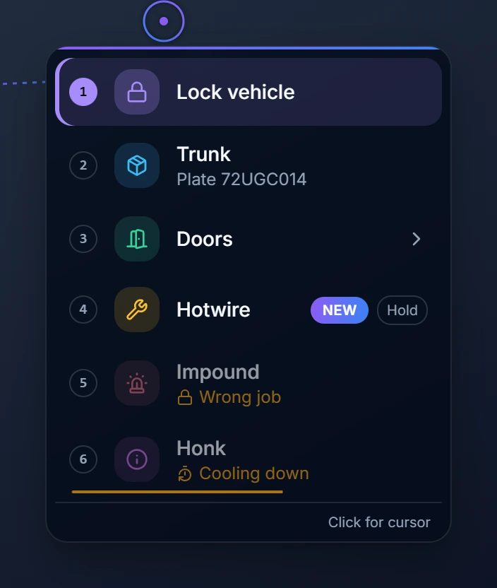
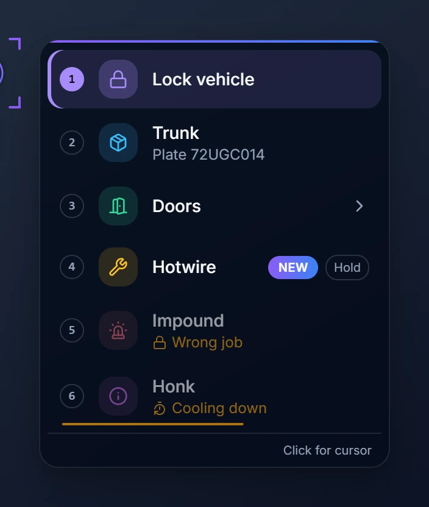
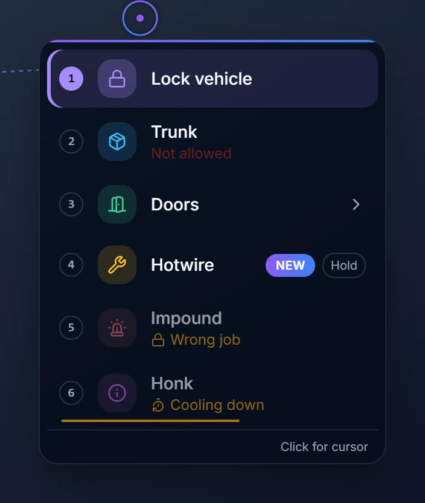

<div align="center">

# ⬢ ug-target

**Third-eye targeting for the UgCore Framework: options float next to what you aim at, and server actions are checked on the server.**

[](https://ugcore.urging.ch/ug-target/introduction)
[](https://github.com/ugcore-project/ug-target/actions/workflows/ci.yml)
[](https://github.com/ugcore-project/ug-target/releases/latest)
[](LICENSE)
[](https://discord.gg/pCJUcyVw5X)

[**Documentation**](https://ugcore.urging.ch/ug-target/introduction) · [**Installation**](https://ugcore.urging.ch/ug-target/installation) · [**Client API**](https://ugcore.urging.ch/ug-target/api) · [**Server actions**](https://ugcore.urging.ch/ug-target/server-actions)


</div>

---

ug-target lets players interact with the world by aiming at it. Hold `Left Alt`, look at a car, a person, a door or a counter, and its options float right next to it.

What the menu shows is decided on the client. What an action does, when it matters, is decided on the server: the server finds the entity itself and checks distance, conditions, hold time and cooldown before your handler runs.

## Features

- 🎯 **Options in the world.** The menu hangs from the point you aim at and follows it, tied by a line. Or a classic list beside the crosshair.
- ✨ **A reticle that reacts.** It breathes while idle and snaps brackets around anything with options. The entity you aim at glows.
- 🎮 **Keyboard, wheel and controller.** Scroll or D-pad to move, `1` to `9` to pick, `E` or `A` to confirm, right-click or `B` to go back. Left click frees the cursor.
- 🔒 **Secure server actions.** `RegisterAction` on the server, `serverAction` on the option. Entity, model, distance, conditions, hold and cooldown are checked again on the server, and cheats are flagged in ug-core's Guard.
- 📋 **Conditions built in.** Job and grade, gang, groups, duty, items, in a vehicle. Options you cannot use stay visible with the reason, or hide.
- ⏳ **Hold to confirm and cooldowns.** A ring fills while you hold. Cooldowns count down on the row.
- 📂 **Submenus, bones, zones.** Sphere, box and poly zones. Options on vehicle doors by bone. Nested menus with back.
- 🔁 **ox_target compatible.** `provide 'ox_target'`: scripts written for it run unchanged.

## Preview

| Options on a car | List layout | Refused by the server |
| :---: | :---: | :---: |
|  |  |  |

## Requirements

- FXServer with **OneSync**
- [**ug-core**](https://github.com/ugcore-project/ug-core) 1.0.0 or newer
- [**ug-lib**](https://github.com/ugcore-project/ug-lib) 1.0.0 or newer

ug-core's **jobs**, **gangs** and **inventory** modules are optional. Conditions that need a disabled module never pass.

## Installation

1. Download `ug-target.zip` from the [latest release](https://github.com/ugcore-project/ug-target/releases/latest) and extract it into your `resources` folder, for example `resources/[ug]/ug-target`. The archive holds the built page. To update, extract the new one over it: your `config.lua` stays.

2. Remove `ox_target` if you run it, then add ug-target to `server.cfg` after its dependencies:

   ```bash
   ensure ug-core
   ensure ug-lib
   ensure ug-target
   ```

3. Start the server. ug-target generates `config.lua` from `server/config.default.lua`.

See the [installation guide](https://ugcore.urging.ch/ug-target/installation) for details.

## Usage

```lua
-- Client: an option on every ATM.
exports['ug-target']:AddModel('prop_atm_01', {
    label = 'Use ATM',
    icon = 'credit-card',
    distance = 1.5,
    onSelect = function(context)
        TriggerEvent('my-bank:open')
    end,
})

-- Client: a server action, shown to players with a lockpick.
exports['ug-target']:AddGlobalVehicle({
    label = 'Lockpick',
    icon = 'key',
    hold = 4000,
    conditions = { items = 'lockpick' },
    serverAction = 'my-resource:Lockpick',
})

-- Server: the action, checked again before it runs.
exports['ug-target']:RegisterAction('Lockpick', {
    distance = 2.0,
    kinds = { 'vehicle' },
    conditions = { items = 'lockpick' },
    hold = 4000,
    cooldown = 10000,
}, function(source, context)
    SetVehicleDoorsLocked(context.entity, 1)
end)
```

See the [Client API](https://ugcore.urging.ch/ug-target/api) and [Server actions](https://ugcore.urging.ch/ug-target/server-actions).

## Configuration

`config.lua` is yours. It is generated on the first start, never overwritten by updates, and checked on every start: any error is logged, and the resource stays idle instead of half working.

```lua
return {
    trigger = 'hold',      -- or 'toggle'
    key = 'LMENU',
    layout = 'anchored',   -- or 'list'
    maxDistance = 7.0,
    outlineColor = { 59, 130, 246, 255 },
}
```

See [Configuration](https://ugcore.urging.ch/ug-target/configuration) for every option.

### Look and features

| Key | Purpose |
| --- | --- |
| `cursor` | `false`: left click no longer frees the cursor. Keyboard, scroll and number keys only. |
| `numberKeys` | `false`: no 1 to 9 key bindings, and rows hide their number. |
| `soundEffects` | `{ name, set }` per `hover`, `select`, `back`, `error`. Leave one out to silence it. |
| `theme` | ug-lib theme overrides for ug-target only. `colors` also takes `brandTo` (gradient end) and `reticle` (idle crosshair). |
| `optionColors` | Hex row colors, one per row in turn. `{}` colors every row with the theme's primary. |
| `look` | `cardWidth`, `cardOpacity`, `blur`, `side` (`auto`, `left`, `right`), `connector`, `pulse`, `reticle` (`brackets`, `dot`, `none`), `hints`, `animations`, `resultDuration`. Merges field by field. |

## Console

| Command | Does |
| --- | --- |
| `ugtarget status` | Server actions with their distance, hold, cooldown and conditions. |

## Project structure

```text
ug-target/
├── fxmanifest.lua
├── shared/              enums, zone shapes, conditions
├── server/              config, server actions, commands
├── client/              options, registry, API, ox_target exports, scanner, input, NUI bridge
├── locales/             en, pt
├── web/                 React page: reticle and option card
├── tests/               Lua 5.4 tests with native mocks, never shipped
├── skills/              task guides for AI agents, never shipped
├── AGENTS.md            rules for AI agents and humans
└── CLAUDE.md            points Claude Code to AGENTS.md
```

## Development

Clone ug-core and ug-lib next to this repository: the tests and the type check read them from `../ug-core` and `../ug-lib`, or from the `UG_CORE` and `UG_LIB` paths.

Every change MUST pass these checks. CI runs them on pushes and pull requests to `dev` and `main`.

```bash
# 1. LuaLS strict check, zero problems, with ug-core and ug-lib as libraries
lua-language-server --check . --checklevel=Information --configpath=.luarc.json

# 2. Runtime tests
for suite in tests/*.lua; do [ "$suite" = tests/helpers.lua ] || lua5.4 "$suite" || exit 1; done

# 3. Manifest and license headers
lua5.4 .github/scripts/check-repository.lua
```

The page needs Node.js 20.19 or newer:

```bash
cd web
npm ci
npm run lint && npm run typecheck && npm test
npm run build && npm run budget   # web/dist, at most 400 KB gzipped
npm run dev                       # browser preview with buttons that play the showcase scenes
npm run capture                   # README images from the scenes, to .github/assets
```

The README images come from the scenes in `web/src/dev/scenes.ts`: see [skills/readme-preview](skills/readme-preview/SKILL.md).

For editor support, install the [Lua](https://marketplace.visualstudio.com/items?itemName=sumneko.lua) and [CfxLua](https://marketplace.visualstudio.com/items?itemName=overextended.cfxlua-vscode) VS Code extensions.

### Conventions

- Lua 5.4. Every file starts with the license header. Every function has LuaLS annotations.
- Server callbacks go through ug-core with a schema and a rate limit. Clients send intent, never coordinates or results.
- Magic values live in `UgTarget.Enums`. NUI enums MUST match `web/src/types/protocol.ts`: `tests/nui.lua` fails when they differ.
- Defaults live in `server/config.default.lua` only, with a comment owners understand.
- Every player-facing text goes through `locales/`. Every locale file has the same keys as `en.json`.

### Working with AI agents

[AGENTS.md](AGENTS.md) holds the conventions and security rules every agent MUST follow. Claude Code reads it through
`CLAUDE.md`; Codex, Cursor and others read `AGENTS.md` directly. Task guides:

| Skill | For |
| --- | --- |
| [server-actions](skills/server-actions/SKILL.md) | Callbacks and net events |
| [nui-page](skills/nui-page/SKILL.md) | The page, its messages and callbacks |
| [config](skills/config/SKILL.md) | Owner config options |
| [testing](skills/testing/SKILL.md) | Lua and web tests |
| [readme-preview](skills/readme-preview/SKILL.md) | README features and images |
| [ug-core-api](skills/ug-core-api/SKILL.md) | What ug-core and ug-lib offer |

### Releases

Releases are automated. release-please keeps a `chore: release X.Y.Z` pull request open on `main` that bumps
`version` in `fxmanifest.lua` and `CHANGELOG.md` from Conventional Commits. Merging it tags `vX.Y.Z`, builds the page
and attaches `ug-target.zip` with only what a server runs. Every push to `dev` replaces the `dev-build` pre-release.
Merge `dev` into `main` with a merge commit, never squash. Commit subjects become the changelog: write them for owners.

## Contributing

Contributions are welcome. Branch off `dev` and open a pull request to `dev`.

- Commits and PR titles follow [Conventional Commits](https://www.conventionalcommits.org): lowercase imperative subject, no trailing period, 72 characters at most. Scopes: `core`, `api`, `scanner`, `actions`, `conditions`, `compat`, `nui`, `web`, `config`, `locale`, `ci`, `deps`.
- Add or extend a test for every change in behavior.
- Translations are welcome: copy `locales/en.json` to your language code and translate the values.

Read the [contributing guide](https://github.com/ugcore-project/.github/blob/main/CONTRIBUTING.md) and the [Code of Conduct](https://github.com/ugcore-project/.github/blob/main/CODE_OF_CONDUCT.md).

## Security

Never report a vulnerability in a public issue. [Report it privately](https://github.com/ugcore-project/ug-target/security/advisories/new) and read the [Security Policy](https://github.com/ugcore-project/.github/blob/main/SECURITY.md).

## Credits

Inspired by [ox_target](https://github.com/overextended/ox_target). ug-target is a new implementation built on UgCore's rules.

## License

ug-target is free software, licensed under the [GNU General Public License v3.0](LICENSE).

Copyright (C) 2026 UgCore Framework & Contributors.
